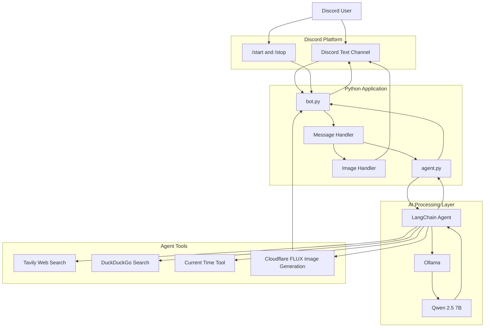
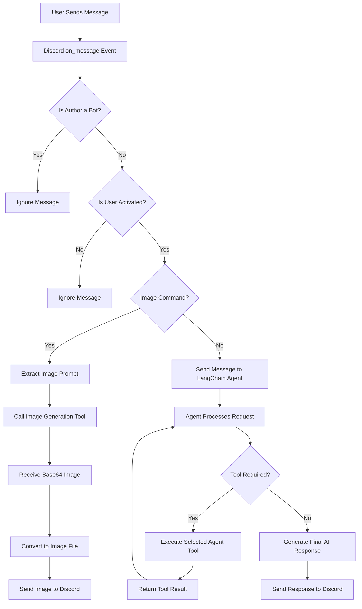
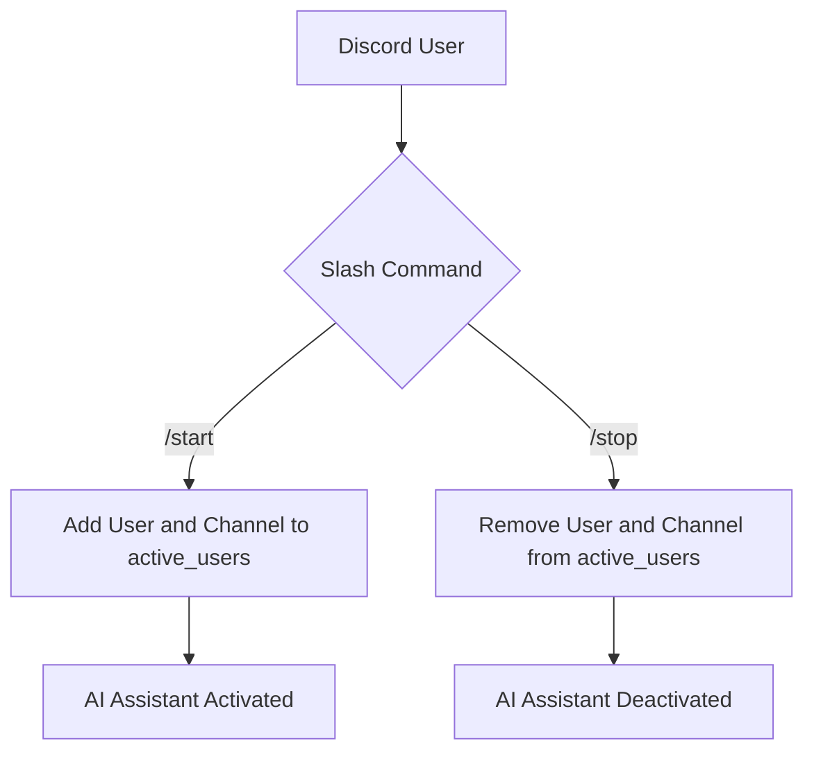
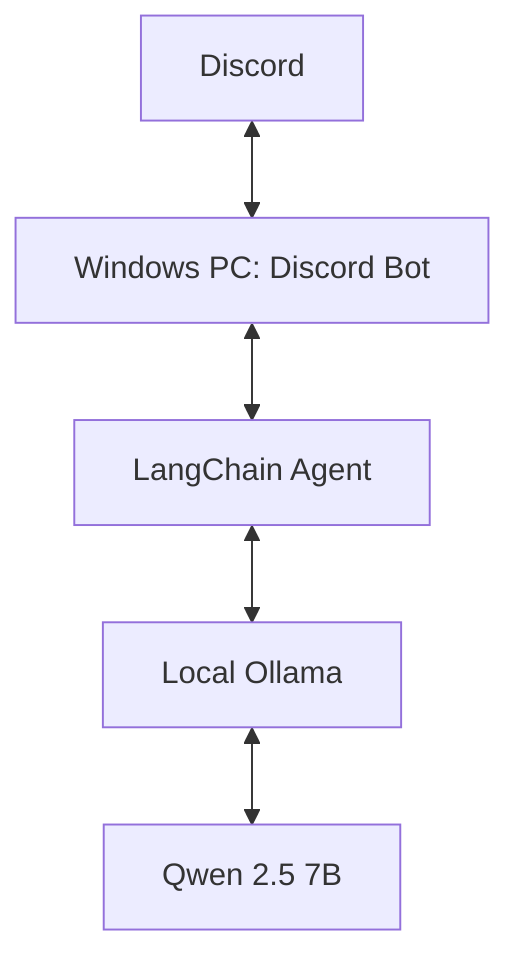
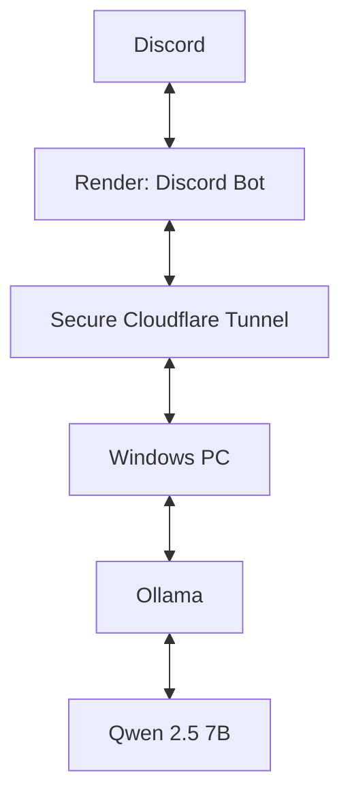

# Discord AI Agent

**An intelligent AI-powered Discord assistant built with Python, LangChain, Ollama, and Qwen 2.5 7B.**

Bring local AI conversations, intelligent agent tools, web search, and AI image generation directly into your Discord server.

---

## Overview

Discord AI Agent is a Python-based Discord assistant that connects Discord users with an AI agent powered by a locally hosted Large Language Model (LLM).

It uses Ollama to run Qwen 2.5 7B locally and LangChain to orchestrate AI conversations and tools.

The assistant also supports image generation, web search, and channel-based activation.

## Features

- **AI Chat:** Conversational AI powered by Qwen 2.5 7B.
- **Local LLM:** Run inference locally using Ollama.
- **AI Agent:** Tool orchestration using LangChain.
- **Image Generation:** Generate images from text prompts.
- **Web Search:** Integrated Tavily and DuckDuckGo search tools.
- **Time Tool:** Retrieve current date and time.
- **Discord Integration:** Interact with AI directly from Discord.
- **Channel-Based Activation:** Activate or deactivate the assistant independently in each channel.
- **Slash Commands:** Simple `/start` and `/stop` controls.

---

# System Architecture

The project follows a modular architecture with separate Discord interaction, agent orchestration, language model, and external tool layers.

## Architecture Diagram



## Architecture Components

| Component | Responsibility |
|---|---|
| `bot.py` | Discord client, events, commands, message handling |
| `agent.py` | AI agent, model configuration, tools |
| LangChain | Agent orchestration and tool execution |
| Ollama | Local LLM runtime |
| Qwen 2.5 7B | Language model |
| Tavily | Web search |
| DuckDuckGo | Alternative web search |
| Cloudflare FLUX | Image generation |

---

# Message Processing Flow

The following diagram describes how a normal Discord message is processed.



## Activation Flow



---

# Project Structure

```text
Discord-AI-Agent/
│
├── bot.py
│   ├── Discord client setup
│   ├── Slash commands
│   ├── Message handling
│   ├── AI chat integration
│   └── Image generation handling
│
├── agent.py
│   ├── Ollama model configuration
│   ├── LangChain agent
│   ├── Tavily search tool
│   ├── DuckDuckGo search tool
│   ├── Current time tool
│   └── Image generation tool
│
├── .env
│   └── API credentials (not committed)
│
├── .gitignore
│
├── README.md
│
└── requirements.txt
```

---

# Technology Stack

| Technology | Usage |
|---|---|
| Python 3.12 | Application development |
| Discord.py | Discord API integration |
| LangChain | AI agent framework |
| Ollama | Local model runtime |
| Qwen 2.5 7B | Language model |
| Tavily | Web search |
| DuckDuckGo | Search integration |
| Cloudflare Workers AI | Image generation |
| FFmpeg | Not required by the text-and-image bot |

---

# Installation and Setup

## 1. Clone Repository

```bash
git clone https://github.com/Raj-Rathod-Ai/Discord-Ai-Agent.git
cd Discord-Ai-Agent
```

## 2. Install Ollama

Download Ollama:

https://ollama.com/download

Pull the Qwen model:

```bash
ollama pull qwen2.5:7b
```

Run Ollama:

```bash
ollama run qwen2.5:7b
```

## 3. Install Dependencies

Using uv:

```bash
uv sync
```

Alternatively, install the dependencies declared in your requirements file:

```bash
pip install -r requirements.txt
```

## 4. Environment Configuration

Create a `.env` file:

```env
DISCORD_API_KEY=your_discord_bot_token
TAVILY_API_KEY=your_tavily_api_key
CLOUDFLARE_ACCOUNT_ID=your_cloudflare_account_id
CLOUDFLARE_API_TOKEN=your_cloudflare_api_token
```

Add any other credentials required by your actual `agent.py` configuration.

**Never upload `.env` to GitHub.**

## 5. Run the Discord Bot

```bash
uv run bot.py
```

---

# Discord Commands

| Command | Description |
|---|---|
| `/start` | Activate the AI assistant in the current channel |
| `/stop` | Deactivate the AI assistant in the current channel |
| `!imagine <prompt>` | Generate an AI image |
| Normal message | Chat with the AI assistant |

---

# Deployment Architecture

The application can run locally or use a hybrid cloud architecture.

### Local Deployment



### Hybrid Cloud Deployment



In hybrid deployment, the Discord bot runs on Render while Ollama remains on your own computer. The computer must stay powered on and connected to the internet.

---

# Security

- Never commit Discord bot tokens.
- Never publish API credentials.
- Keep `.env` excluded from Git.
- Do not expose the Ollama API directly to the public internet.
- Use authenticated, encrypted connections for remote model access.

---

# Future Improvements

- Persistent conversation memory.
- Multi-server configuration.
- User-specific conversation context.
- More AI tools and integrations.
- Secure cloud deployment.
- Improved agent observability.
- Streaming AI responses.
- Persistent activation settings.

---

# Author

**Raj Rathod**

GitHub: [@Raj-Rathod-Ai](https://github.com/Raj-Rathod-Ai)

Project: [Discord-Ai-Agent](https://github.com/Raj-Rathod-Ai/Discord-Ai-Agent)
